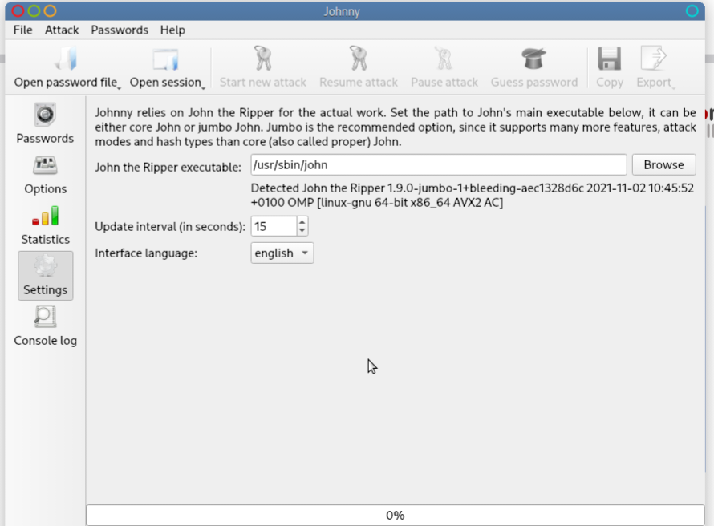
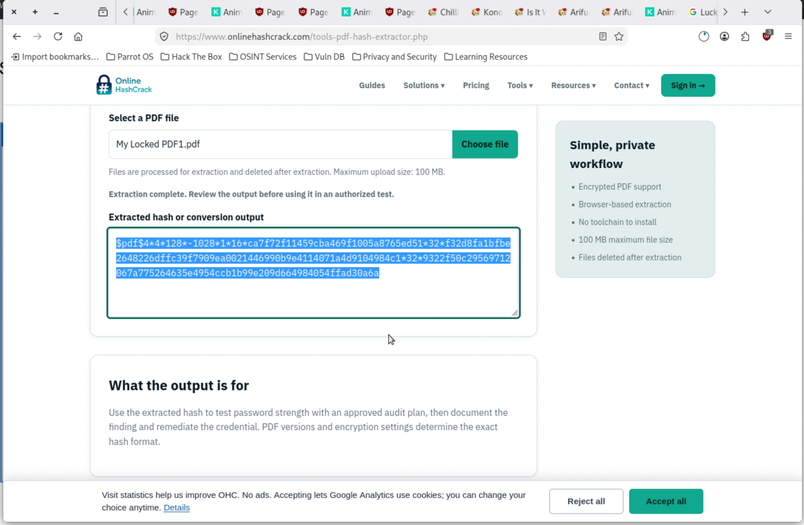
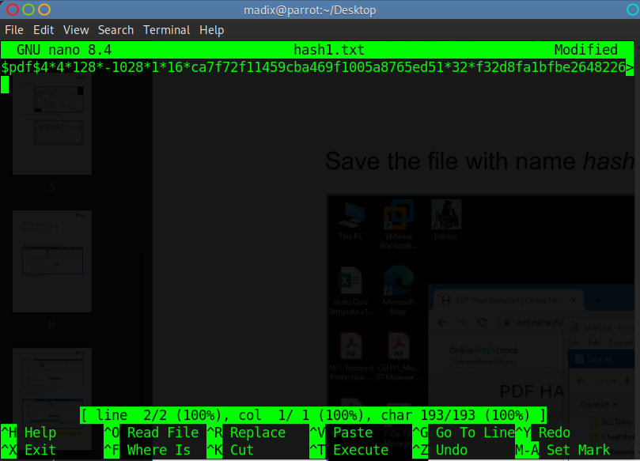
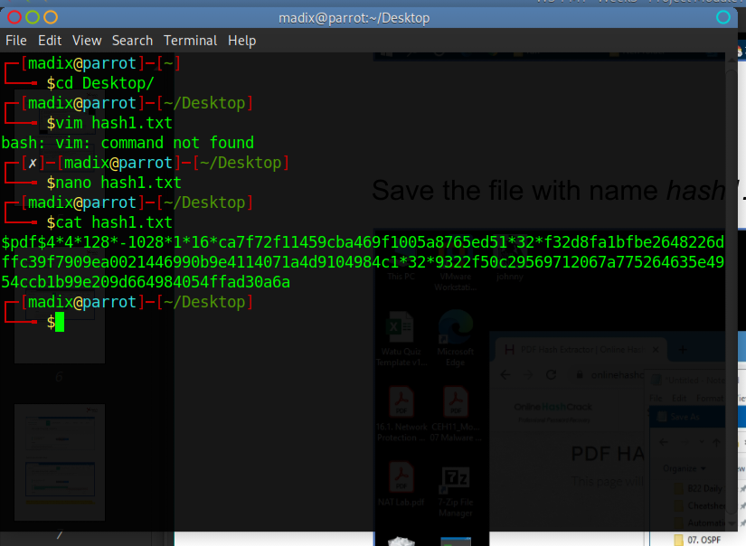
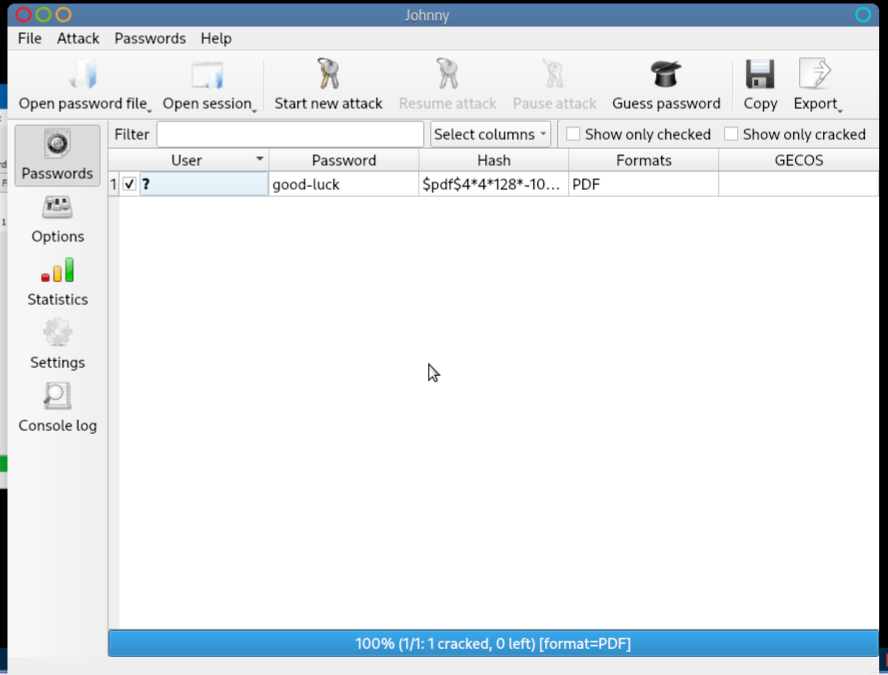
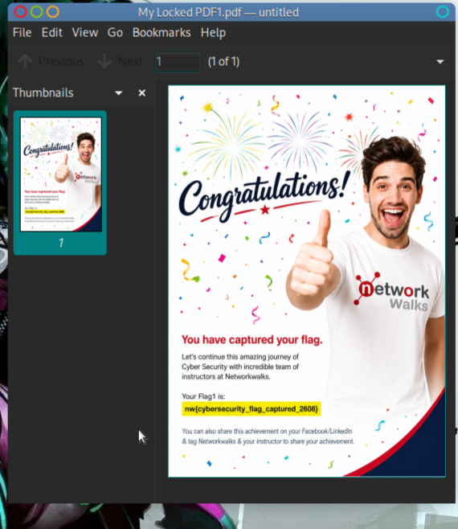

# 🔐 PASSWORD CRACKING

**USing JTR GUI To Obtain The Right Password*

<h2>Introduction</h2>

  This labwork made use of John The Ripper and Johnny to perform password cracking.John the Ripper (JTR) is a free, open-source command-line password cracking and security auditing tool, while Johnny is its graphical user interface (GUI) front-end.Security professionals, system administrators, and ethical hackers use both tools together to test password strength, audit systems for weak credentials, and recover forgotten password.

To  briefly explain how both work,It basically makes use of the hash of the encrypted file and a wordlist. Then the tool uses every word in the wordlist to try and guess the password.Depending on your computers resources it can be done in a matter of seconds or in minutes. It also has a feature to guess your password but one thing to note is that the more complex the password is, the more time it takes to guess it or it might not even be able to guess it in the end.      

So here is how it works step by step:
<ul>
  <li> Johnny GUI is must be downloaded,installed and properly configured.</li>
  
  
  <li> A wordlist must be obtained like rockyou.txt</li>
  
  <li>The hash of the encrypted file must be obtained and put into a .txt file</li>
  
  

  

  
  
  <li> The GUI must be pointed to the txt file with the hash  </li>
  
  <li> After that the cracking may begin which may take some time. After this the password is given. </li>

  

<li> Then the encrypted file is opened and the password obtained is given. After this the file opens. </li>

  

</ul>

