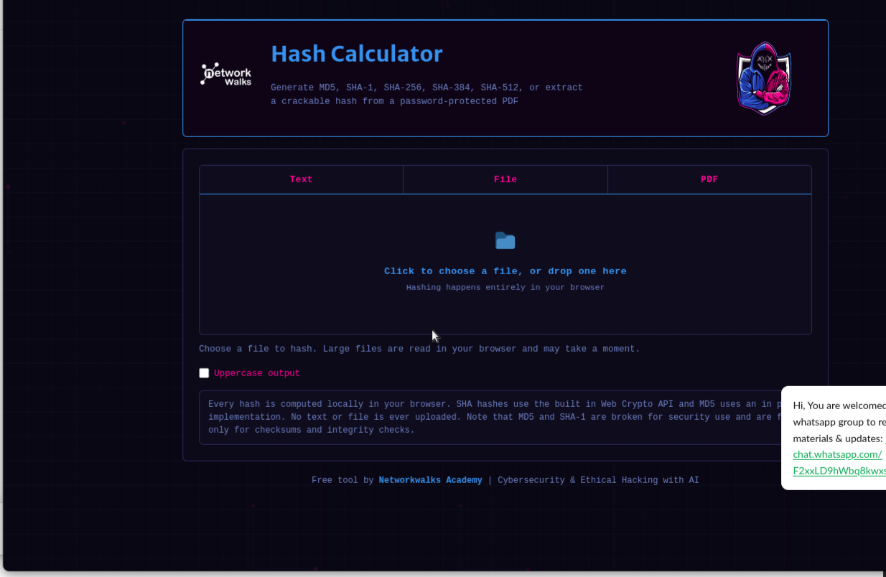
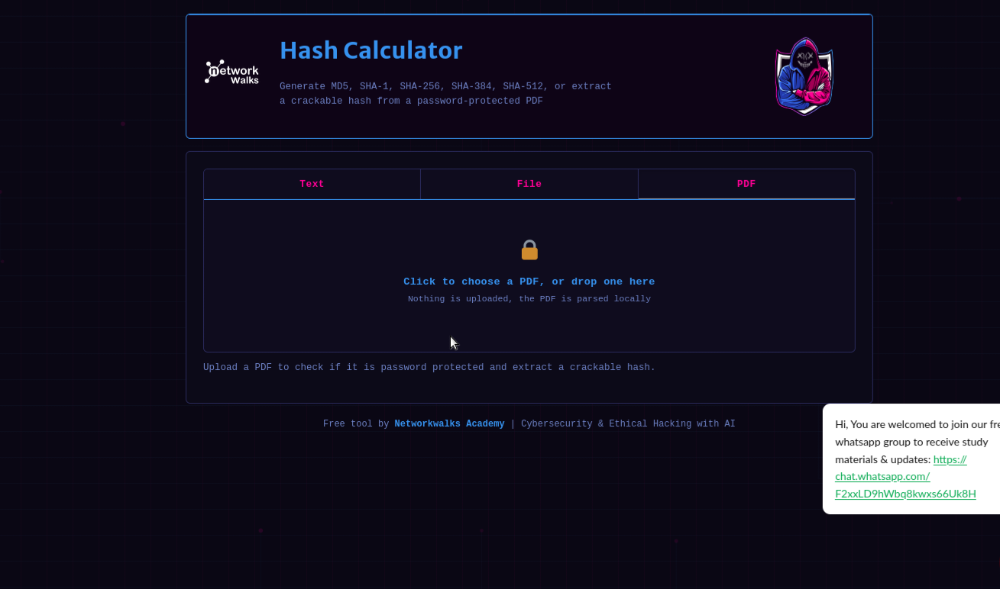
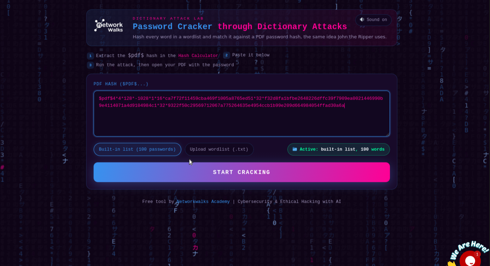
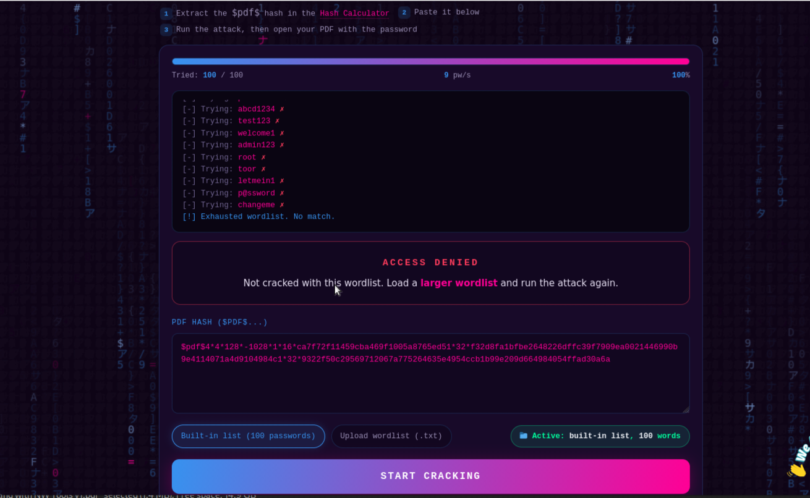
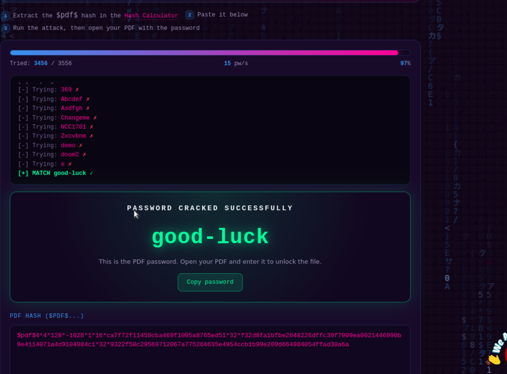
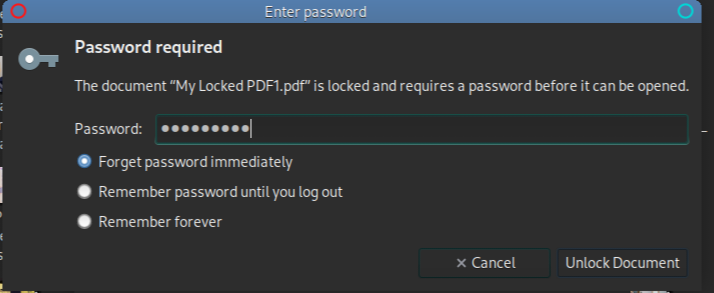
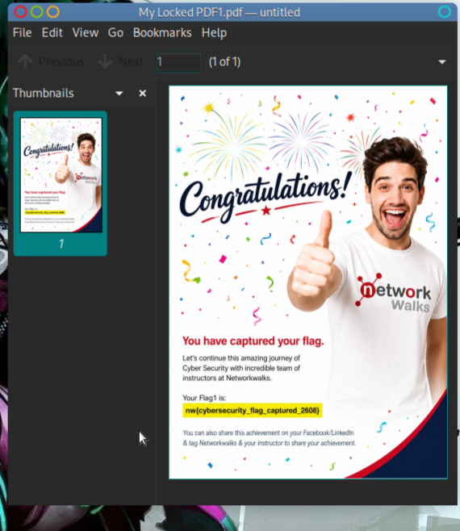

# 🔐 PASSWORD CRACKING

**USing Networkwalks  Password-Cracking Tool To Obtain The Right Password*

<h2>Introduction</h2>

  This labwork made use of a web based password cracking tool made by NetworkWalks to perform password cracking.This web tool not only allows you to obtain the hash of the file right away, but it allows you to also use 100 randomly generated words or upload a wordlist to be used.

To  briefly explain how both work,It basically makes use of the hash of the encrypted file and a wordlist. Then the tool uses every word in the wordlist to try and guess the password.Depending on your computers resources it can be done in a matter of seconds or in minutes.    

So here is how it works step by step:
<ul>
 <li> This website is visited first : https://networkwalks.com/hash-calculator/</li>
  
  

  <li> The encrypted file is then uploaded to the website. In this case the file is a pdf.After that the hash is copied</li>

  

  <li>This website is visited next: https://networkwalks.com/password-cracker/  .</li>
  <li>When that is done, the hash copied is pasted and you have the option to either use the built-in passwords or a wordlist. After some time the password will be given</li>
   
   

  

   

   <li> The next thing to do is to copy the password and use it to open the encrypted file</li>
    
  

   

  

 
